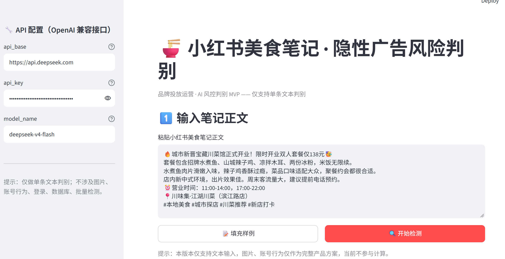
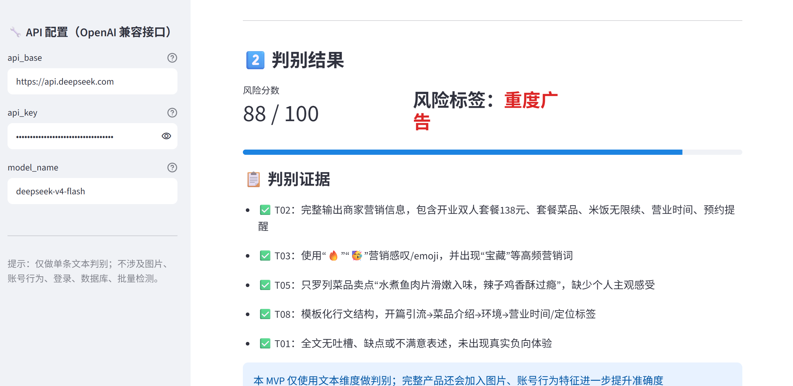

# 小红书美食笔记 · 隐性广告风险判别工具

面向品牌投放运营的 AI 风控判别 MVP：输入小红书美食笔记正文，基于文本风控特征体系（T01–T08），调用大模型输出 **0–100 风险分数**、**三级风险标签**（真实分享 / 轻度植入 / 重度广告）以及**判别证据溯源列表**。

> ⚠️ 本项目为策略验证 MVP，仅落地「文本维度」判别，不包含爬虫、图片、账号行为、登录、数据库、批量检测。

## 效果演示

| 输入页 | 结果页 |
|---|---|
|  |  |

## 功能特性

- **单条文本判别**：粘贴笔记正文 → 输出风险分数 + 标签 + 证据溯源
- **OpenAI 兼容接口**：`api_base` / `api_key` / `model_name` 在页面填写，不硬编码
- **三级风险标签**：真实分享(0–30) / 轻度植入(31–70) / 重度广告(71–100)
- **证据溯源**：每条证据关联特征编号 T01–T08，且强制来自原文、禁止编造
- **边界样本提示**：分数落在 35–65 时提示人工复核
- **用户反馈**：👍/👎 反馈按钮（仅前端演示，不落库）
- **异常处理**：空输入 / 文本过短(<30字) / API 调用失败 / JSON 解析失败

## 快速开始

```bash
# 安装依赖
pip install -r requirements.txt

# 启动
streamlit run app.py
```

打开 http://localhost:8501，在左侧「API 配置」填入 `api_base`、`api_key`、`model_name`，点击「填充样例」→「开始检测」即可。

## 目录结构

```
.
├── app.py                      # Streamlit 主程序（含 System Prompt）
├── system_prompt.txt           # 判别 System Prompt（已内嵌进 app.py）
├── requirements.txt            # 依赖：streamlit, openai
├── screenshots/                # 效果截图
├── 风控特征体系.md              # 文本/图像/账号三维特征体系
├── MVP界定与BadCase库.md        # MVP 范围界定 & Bad Case 案例库
└── PRD.md                      # PRD 要点 & 评测数据集
```

## 风险特征体系（文本维度）

| 编号 | 特征 | 信号指向 |
|---|---|---|
| T01 | 全文零负面评价 | 偏向重度广告 > 轻度植入 |
| T02 | 完整营销信息（价格/优惠/营业时间/预约） | 偏向重度广告 |
| T03 | 营销话术（感叹号/emoji/高频词） | 偏向广告 |
| T04 | 模板痕迹（多博主句式雷同） | 偏向重度广告 |
| T05 | 缺少个人主观感受 | 偏向重度广告 |
| T06 | 生活化瑕疵细节 | 偏向真实分享 |
| T07 | 个人随机细节 | 偏向真实分享 |
| T08 | 模板化行文结构 | 偏向轻度/重度广告 |

## 免责声明

- 本项目仅用于策略验证，不构成商业投放决策依据。
- 判别证据由大模型生成，可能存在幻觉；生产环境需对边界样本进行人工复核。
